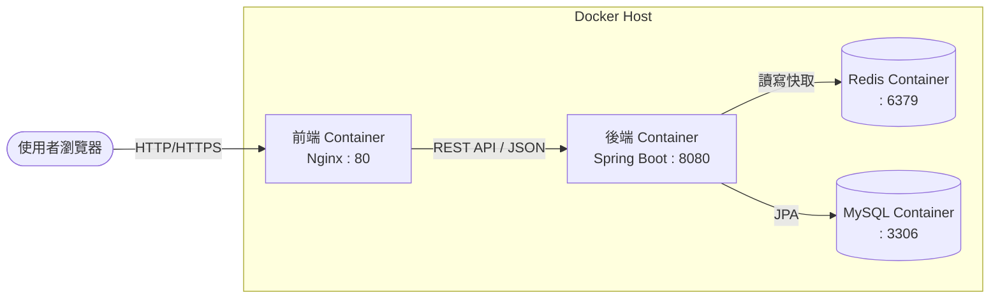

# HeadSpa Booking System｜頭部經絡按摩預約管理系統

一個完整的頭部經絡按摩預約管理系統，涵蓋會員預約、芳療師班表管理、後端 REST API、快取與部署到 AWS 的完整流程。這個 repo 是**後端**（Spring Boot + MySQL + Redis）；前端請見 [headspa-frontend](https://github.com/lindachang-8168/headspa-frontend)。

## 🌐 Live Demo

| 角色 | 網址 |
|---|---|
| 會員登入 | http://98.82.248.135 |
| 芳療師登入 | http://98.82.248.135/therapist.html |
| 後端 API | http://98.82.248.135:8080/api/therapists |

**示範帳號（芳療師，用手機號碼登入）：**

| 手機號碼 | 姓名 | 專長 |
|---|---|---|
| 0920234567 | Ethan | 護眼舒壓 |
| 0960234567 | Luna | 頭部筋絡疏導 |
| 0980234567 | James | 頭皮護理 |
| 0980111222 | Lola | 護眼明眸 |

會員端沒有預設帳號，直接輸入任意手機號碼登入，找不到會跳出註冊表單，現場建立新會員即可體驗。

## 🏗 系統架構



- **前端**：純 HTML / CSS / JavaScript（無框架），用 `fetch` 呼叫後端 REST API，由 Nginx 提供靜態頁面
- **後端**：Spring Boot 3 + Spring Data JPA + Spring Data Redis
- **資料庫**：MySQL 8.4（會員、芳療師、預約資料）
- **快取**：Redis 7（芳療師的預約查詢結果快取，5 分鐘 TTL，並支援 Redis 斷線時自動降級直接查資料庫）
- **部署**：Docker Compose 一鍵啟動四個服務，透過 GitHub Actions 自動 SSH 部署到 AWS EC2

## ✨ 功能

**會員**
- 手機號碼登入 / 現場註冊
- 選芳療師、日期、時間送出預約，並即時顯示該芳療師當天已被預約的時段
- 查看預約紀錄、取消預約
- 修改個人資料

**芳療師**
- 手機號碼登入 / 現場建立帳號（含課程 / 專長欄位）
- 查看今日預約，並可直接調整服務狀態（已預約 → 已確認 → 已完成 / 已取消）
- 月班表：切換月份查看整月預約
- 客戶資料：自動彙整服務過的不重複客戶清單與累計預約次數
- 修改個人資料

## 🛠 技術棧

`Java 17` `Spring Boot 3.3` `Spring Data JPA` `Spring Data Redis` `MySQL 8.4` `Redis 7` `Docker` `Docker Compose` `Nginx` `GitHub Actions (CI/CD)` `AWS EC2`

## 📁 專案結構

```
headspa-redis/
├── src/main/java/com/headspa/redis/
│   ├── config/       # CORS、Redis 設定
│   ├── controller/   # REST API
│   ├── model/        # JPA Entity
│   ├── repository/   # Spring Data JPA Repository
│   └── service/      # 業務邏輯（含 Redis 快取策略）
├── src/main/resources/application.yaml
├── docker-compose.yml   # mysql / redis / app / frontend 四個服務
├── Dockerfile            # 多階段建置（Maven build → JRE 執行環境）
└── .github/workflows/deploy.yml   # push 到 master 自動部署到 AWS
```

## 🔌 API 端點

| 方法 | 路徑 | 說明 |
|---|---|---|
| GET | `/api/users` | 取得所有會員 |
| POST | `/api/users` | 建立會員 |
| PUT | `/api/users/{id}` | 更新會員資料 |
| GET | `/api/therapists` | 取得所有芳療師 |
| POST | `/api/therapists` | 建立芳療師 |
| PUT | `/api/therapists/{id}` | 更新芳療師資料 |
| GET | `/api/appointments/user/{userId}` | 查詢某會員的預約紀錄 |
| GET | `/api/appointments/therapist/{therapistId}` | 查詢某芳療師的預約（含 Redis 快取） |
| POST | `/api/appointments` | 建立預約 |
| PUT | `/api/appointments/{id}` | 更新預約狀態 / 取消預約 |

## 🚀 本機執行

```bash
git clone https://github.com/lindachang-8168/headspa-redis.git
git clone https://github.com/lindachang-8168/headspa-frontend.git
cd headspa-redis

# 建立 .env，填入你要用的 MySQL 密碼
echo "MYSQL_PASSWORD=your_password" > .env

# 同時啟動後端 + MySQL + Redis + 前端
docker compose --profile frontend up -d --build
```

啟動後：前端 `http://localhost`，後端 API `http://localhost:8080`。

## ☁️ 部署

`headspa-redis` 與 `headspa-frontend` 是兩個獨立 repo，但部署到主機時會被 clone 到同一層目錄，讓 `docker-compose.yml` 裡的 `../headspa-frontend` 相對路徑能正確找到前端。push 到 `master` 分支時（兩個 repo 皆同），GitHub Actions 會自動 SSH 進 AWS 主機、拉最新程式碼、重新建置並啟動全部服務。