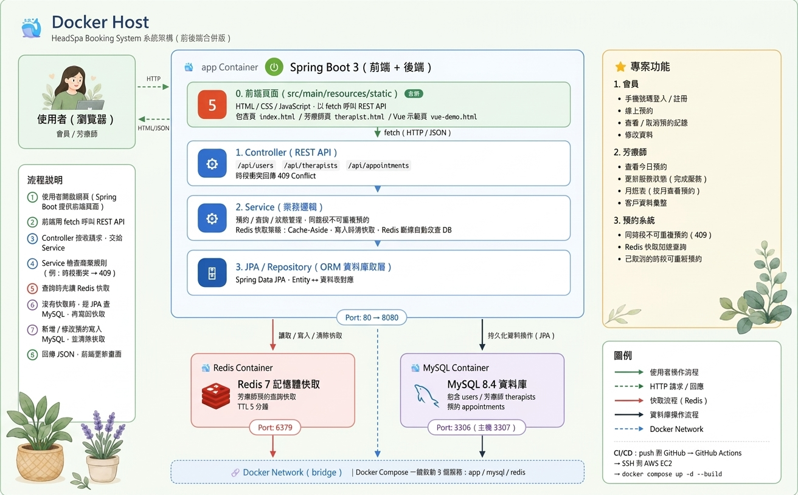

# HeadSpa Booking System｜頭部經絡按摩預約管理系統

一個完整的頭部經絡按摩預約管理系統，涵蓋會員預約、芳療師班表管理、後端 REST API、快取與部署到 AWS 的完整流程。前後端已合併在同一個 repo：前端頁面放在 `src/main/resources/static`，由 Spring Boot 直接提供（Spring Boot + MySQL + Redis）。

## 🌐 Demo

> 原本部署在 AWS EC2 的線上版本已停用，請依下方「🚀 本機執行」用 Docker 一鍵啟動後瀏覽。

| 頁面 | 網址（本機） |
|---|---|
| 會員登入 | http://localhost |
| 芳療師登入 | http://localhost/therapist.html |
| Vue 示範頁（假資料） | http://localhost/vue-demo.html |
| 後端 API | http://localhost/api/therapists |

**芳療師帳號範例（用手機號碼登入；新資料庫是空的，第一次登入時找不到會跳出表單，現場建立即可）：**

| 手機號碼 | 姓名 | 專長 |
|---|---|---|
| 0920234567 | Ethan | 護眼舒壓 |
| 0960234567 | Luna | 頭部筋絡疏導 |
| 0980234567 | James | 頭皮護理 |
| 0980111222 | Lola | 護眼明眸 |

會員端沒有預設帳號，直接輸入任意手機號碼登入，找不到會跳出註冊表單，現場建立新會員即可體驗。

## 🏗 系統架構



- **前端**：純 HTML / CSS / JavaScript（無框架），用 `fetch` 呼叫後端 REST API，放在 `src/main/resources/static`，由 Spring Boot 直接提供（同網域，不需處理 CORS）；另附 Vue 3 示範頁 `vue-demo.html`（卡片式介面、客戶姓名遮罩，使用假資料、不連後端）
- **後端**：Spring Boot 3 + Spring Data JPA + Spring Data Redis
- **資料庫**：MySQL 8.4（會員、芳療師、預約資料）
- **快取**：Redis 7（芳療師的預約查詢結果快取，5 分鐘 TTL，並支援 Redis 斷線時自動降級直接查資料庫）
- **部署**：Docker Compose 一鍵啟動三個服務（mysql / redis / app），透過 GitHub Actions SSH 部署到 AWS EC2（AWS 目前已停用，workflow 改為手動觸發）

## ✨ 功能

**會員**
- 手機號碼登入 / 現場註冊
- 選芳療師、日期、時間送出預約；同一位芳療師同一時段不能重複預約（後端檢查，衝突時回傳 409 並提示選其他時段，已取消的預約不佔用時段）
- 查看預約紀錄、取消預約
- 修改個人資料

**芳療師**
- 手機號碼登入 / 現場建立帳號（含課程 / 專長欄位）
- 查看今日預約，並可直接調整服務狀態（已預約 → 已確認 → 已完成 / 已取消）
- 月班表：切換月份查看整月預約
- 客戶資料：自動彙整服務過的不重複客戶清單與累計預約次數
- 修改個人資料

## 🛠 技術棧

`Java 17` `Spring Boot 3.3` `Spring Data JPA` `Spring Data Redis` `MySQL 8.4` `Redis 7` `Docker` `Docker Compose` `GitHub Actions (CI/CD)` `AWS EC2`

## 📁 專案結構

```
headspa-redis/
├── src/main/java/com/headspa/redis/
│   ├── config/       # CORS、Redis 設定
│   ├── controller/   # REST API
│   ├── model/        # JPA Entity
│   ├── repository/   # Spring Data JPA Repository
│   └── service/      # 業務邏輯（含 Redis 快取策略）
├── src/main/resources/
│   ├── application.yaml
│   └── static/       # 前端頁面 index.html（會員）、therapist.html（芳療師）
├── docker-compose.yml   # mysql / redis / app 三個服務
├── Dockerfile            # 多階段建置（Maven build → JRE 執行環境）
└── .github/workflows/deploy.yml   # GitHub Actions 部署到 AWS（目前為手動觸發）
```

## 🔌 API 端點

| 方法 | 路徑 | 說明 |
|---|---|---|
| GET | `/api/users` | 取得所有會員 |
| POST | `/api/users` | 建立會員 |
| PUT | `/api/users/{id}` | 更新會員資料 |
| GET | `/api/therapists` | 取得所有芳療師 |
| POST | `/api/therapists` | 建立芳療師 |
| PUT | `/api/therapists/{id}` | 更新芳療師資料 |
| GET | `/api/appointments/user/{userId}` | 查詢某會員的預約紀錄 |
| GET | `/api/appointments/therapist/{therapistId}` | 查詢某芳療師的預約（含 Redis 快取） |
| POST | `/api/appointments` | 建立預約（時段已被預約時回傳 409） |
| PUT | `/api/appointments/{id}` | 更新預約狀態 / 取消預約 |

## 🚀 本機執行

```bash
git clone https://github.com/lindachang-8168/headspa-redis.git
cd headspa-redis

# 建立 .env，填入你要用的 MySQL 密碼
echo "MYSQL_PASSWORD=your_password" > .env

# 啟動 MySQL + Redis + app（app 內含前端頁面）
docker compose up -d --build
```

啟動後：前端 `http://localhost`（或 `http://localhost:8080`），後端 API `http://localhost/api/...`。

不用 Docker 也可以：本機開好 MySQL 與 Redis 後，在 IDE 直接執行 `RedisApplication`，瀏覽器打開 `http://localhost:8080` 即可。

## 🐳 Docker Hub

前後端合併後只剩一個 image（Spring Boot，內含前端頁面）：

| Image | Docker Hub |
|---|---|
| app（Spring Boot + 前端） | [`lindachang8168/headspa-backend`](https://hub.docker.com/r/lindachang8168/headspa-backend) |

```bash
docker pull lindachang8168/headspa-backend:latest
```

> 註：Docker Hub 上的 `headspa-backend` 要重新 build 並 push 一次才會包含前端頁面；舊的 `lindachang8168/headspa-frontend`（Nginx）已不再需要。

## ☁️ 部署

GitHub Actions workflow（`.github/workflows/deploy.yml`）會 SSH 進 AWS EC2、拉最新程式碼、`docker compose up -d --build` 重新建置並啟動全部服務。

> 目前 AWS 主機已停用，workflow 改為**手動觸發**（Actions → Run workflow）。重新啟用時，把觸發條件改回 `push: master`，並在 repo Settings → Secrets 設定 `AWS_HOST`、`AWS_USER`、`AWS_SSH_KEY`。